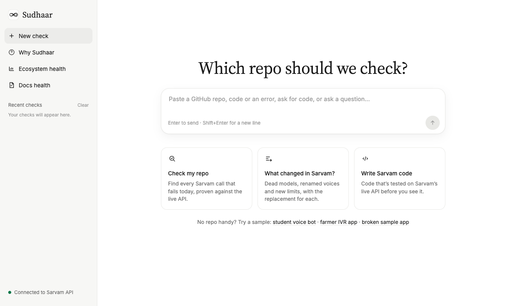
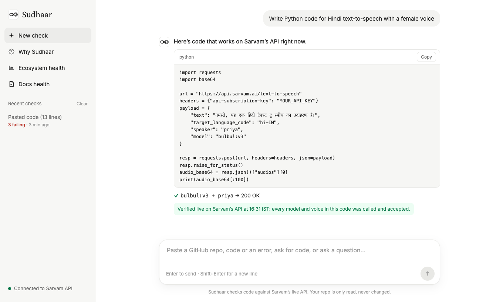
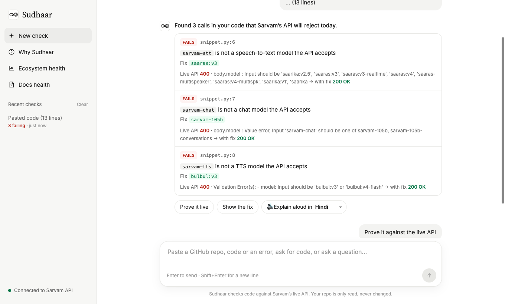
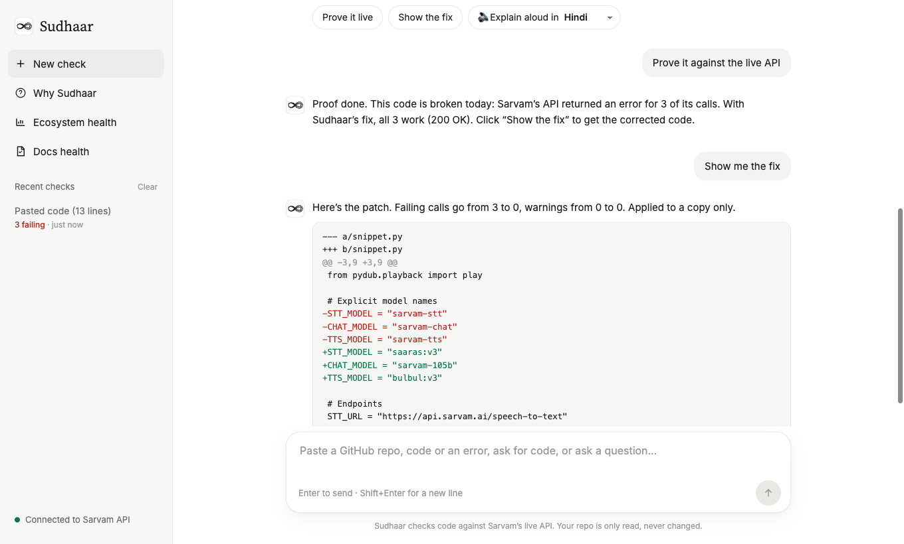
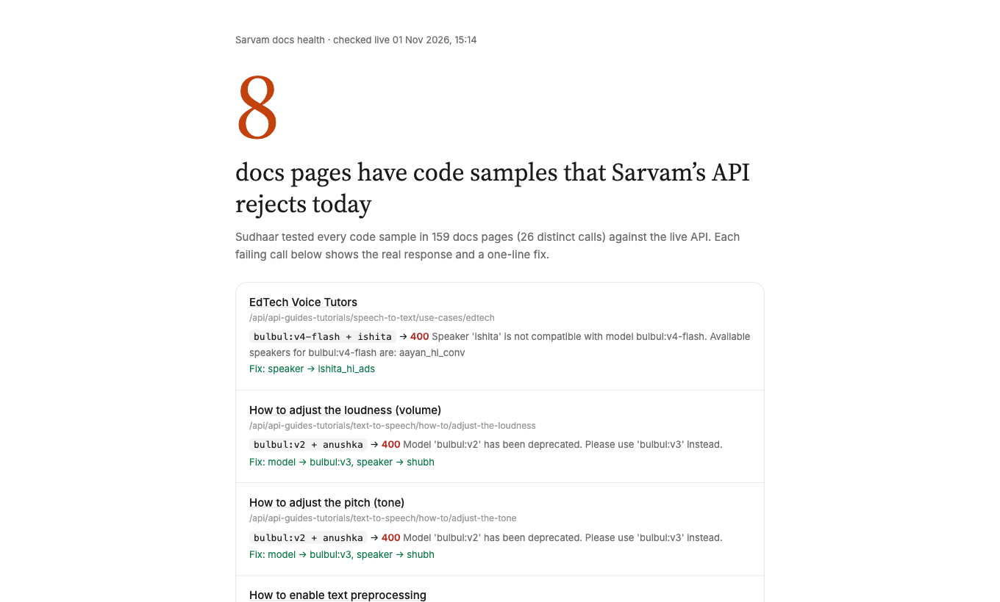
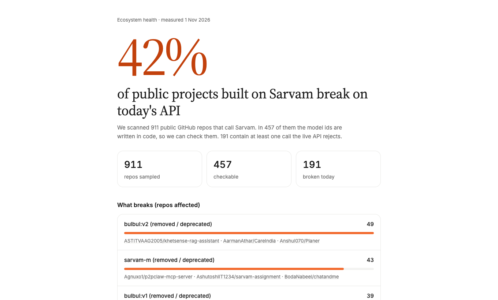
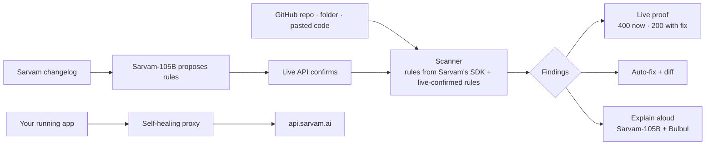

<div align="center">

# Sudhaar · सुधार

**Find, prove and fix the Sarvam AI API calls that break.**
*Skills teach. Sudhaar verifies.*

### 🔗 [Try it live: sudhaar-nu.vercel.app](https://sudhaar-nu.vercel.app)

Built at **Sarvam Campus ’26 × IIT Bombay** (1 Nov 2026) · Python standard library only · Uses Sarvam-105B, Bulbul, Saaras and Mayura

</div>



---

## The problem

Sarvam ships fast. Models get retired (Saarika → Saaras, Bulbul v1 → v2 → v3 → v4 Flash, Sarvam-M → 30B → 105B), voices get renamed, limits change. Code written against older docs, **or written by an AI assistant from stale memory**, then fails with `400 Bad Request`, usually in the middle of a demo.

We measured it, and every rule behind these numbers was confirmed with a real request to `api.sarvam.ai` on 1 Nov 2026:

| | Finding |
|---|---|
| **42%** | of public GitHub projects built on Sarvam that we could check (**191 of 457**) make a call the live API rejects today ([list](ecosystem/broken_repos.md)) |
| **5 / 5** | code samples **Sarvam-105B itself** wrote for Sarvam's API failed on Sarvam's API: invented ids like `sarvam-tts`, `sarvam-stt`, `sarvam-chat`, and the retired voice `meera` ([the files](evidence/ai_written/)) |
| **8** | pages of **Sarvam's own docs** have code samples the API rejects, including *Getting started* and two cookbook voice agents (v3 voices left in v4 examples) |

Sarvam already ships *Agent Skills* because "an assistant's training data goes stale". Skills **teach** the assistant. Nothing **checks** the result. That's the gap Sudhaar fills.

---

## What Sudhaar does

1. **Find:** scans a GitHub repo, a folder or pasted code (Python, JS/TS, notebooks) for every Sarvam call that will fail today.
2. **Prove:** sends the smallest possible real request for each finding: `400` with the current value, `200` with the fix. No guesses.
3. **Fix:** rewrites the call and shows the diff (applied to a copy; your repo is never touched).
4. **Write it right:** ask for code; Sarvam-105B writes it, Sudhaar fixes it and calls every model and voice in it on the live API before you see it.
5. **Learn:** Sarvam-105B reads Sarvam's changelog and proposes new rules; only rules the live API confirms are kept. If the model guesses wrong, the API's own error message names the right model.
6. **Explain:** in Hindi, Tamil, Marathi, Telugu, Bengali, Kannada or English (Sarvam-105B writes it, Bulbul speaks it), and answers follow-up questions or pasted errors.
7. **Protect running apps:** a self-healing proxy fixes broken calls in flight.

---

## Demo: see it in 2 minutes

Open **[sudhaar-nu.vercel.app](https://sudhaar-nu.vercel.app)** and follow along.

### 1 · Get code that's verified live
Click the **Write Sarvam code** card, or type:
```
Write Python code for Hindi text-to-speech with a female voice
```
Sarvam-105B writes it, Sudhaar checks and calls every model and voice in it on Sarvam's live API, then stamps it **Verified live**.



### 2 · Check code an AI wrote, and prove it fails
Sidebar → **Why Sudhaar** → *Check code an AI wrote* (or paste any code). This is Sarvam-105B's own voice agent, unedited. Then click **Prove it live**:



### 3 · Get the fix
Click **Show the fix** for the diff, then **🔊 Explain aloud in [Hindi ▾]** to hear the summary from Bulbul.



### 4 · More to try in the box

| Type or paste | What happens |
|---|---|
| `https://github.com/anyaaa1924/VittBot-GBH` | A real student project: 2 calls fail today (`saarika:v2`, `bulbul:v1`), then **Prove it live** |
| `sarvam-tts kyun fail ho raha hai aur kya use karun?` | Sarvam-105B answers in Hinglish, using the scan |
| A Sarvam error, e.g. `{"error": {"message": "Model 'sarvam-m' has been deprecated…"}}` | The verified fix plus a plain explanation |
| `Write a Python voice assistant: transcribe Hindi audio, answer with Sarvam's chat model, speak the answer` | Three calls (STT, chat, TTS), all verified live |

### 5 · The health pages
**Docs health:** every code sample in Sarvam's docs, checked live, each failure with a one-line fix.



**Ecosystem health:** the 42% scan of public GitHub, by what breaks.



---

## Features

| | Feature | Notes |
|---|---|---|
| 🔍 | **Scanner** | Python, JS/TS, JSON, `.ipynb`; dead models, invented ids, wrong voices per model (all 222 Bulbul v4 voices), retired voices, pace ranges, wrong field names (`voice` → `speaker`), Odia `od-IN`/`or-IN`, typed defaults and `*_MODEL` constants |
| ✅ | **Live proof** | Tiny real calls to Sarvam's TTS, STT, chat and translate APIs: 400 before, 200 after |
| 🛠 | **Auto-fix** | Exact-character rewrites with a unified diff; never renames a variable, only request-body keys |
| ✍️ | **Write it right** | Grounded Sarvam-105B → fix → live check → verified stamp |
| 🧠 | **Learning agent** | `--learn`: Sarvam-105B reads 60+ changelog pages; the live API confirms each rule |
| 🗣 | **Explain aloud** | Sarvam-105B + Bulbul in 7 languages |
| 💬 | **Ask & paste errors** | Answers grounded in the scan and verified facts; pasted errors get the exact fix |
| 🩺 | **Docs & ecosystem health** | Live reports on Sarvam's docs and on 911 public repos |
| 🔁 | **Self-healing proxy** | Change one URL: dead models, wrong voices, pace and fields fixed in flight; OpenAI-style requests (Bearer auth, array content) converted; 429/5xx retried with backoff; TTS over 2,500 characters split and joined into one audio; every change reported in `X-Sudhaar-Fixed` |
| 🤖 | **Agent Skill + MCP** | `skills/sudhaar/SKILL.md` and `mcp_server.py` for Claude Code, Cursor and other coding agents |
| 🚦 | **CI gate** | GitHub Action (`action.yml`) and pre-commit hook; exits 1 on failing calls |

---

## How it works



- **Rules stay current:** model ids, voices and language codes are generated from Sarvam's own SDK types (`--refresh-rules`). Deprecations come from the changelog and are kept only after the live API confirms them.
- **The API is the source of truth:** testing corrected five of our own doc-based rules (for example, `saarika:v2.5` is still accepted, while `bulbul:v2` is now rejected).
- **Built to be trusted:** repos are downloaded read-only and never executed; fixes go to a copy; the API key stays on the server; costly calls are rate-limited.

---

## Use it where you code

```bash
# CLI
export SARVAM_API_KEY=your-key
python3 sudhaar.py github:owner/repo --verify     # find + prove
python3 sudhaar.py ./my-app --fix                 # rewrite + diff
python3 sudhaar.py ./my-app --explain hi-IN       # spoken summary
python3 sudhaar.py --learn                        # learn rules from Sarvam's changelog

# Portal (same engine)
python3 portal.py                                 # http://localhost:8000
```

**CI**, in any repo that calls Sarvam:
```yaml
- uses: ATHARV-IIT-BOMBAY/sudhaar@main
  with: { path: ., verify: true, sarvam-api-key: "${{ secrets.SARVAM_API_KEY }}" }
```

**Self-healing proxy:** point your Sarvam base URL at `https://sudhaar-nu.vercel.app/proxy` (your own key is forwarded):
```bash
curl https://sudhaar-nu.vercel.app/proxy/text-to-speech -H "api-subscription-key: $SARVAM_API_KEY" \
  -H "Content-Type: application/json" \
  -d '{"text":"नमस्ते","target_language_code":"or-IN","model":"bulbul:v2","voice":"meera","pace":2.5}'
# → 200 OK, X-Sudhaar-Fixed: bulbul:v2->bulbul:v3; voice->speaker; meera->shubh; pace 2.5->2.0; or-IN->od-IN
```
The same request sent straight to Sarvam returns `400`.

**AI coding agents:** add `skills/sudhaar/SKILL.md` as a skill, or the MCP server:
```json
{"mcpServers": {"sudhaar": {"command": "python3", "args": ["/path/to/sudhaar/mcp_server.py"], "env": {"SARVAM_API_KEY": "<key>"}}}}
```

---

## Project structure

```
sudhaar.py            engine + CLI (scanner, live proof, fix, learn, explain)
portal.py · *.html    chat portal, health pages, proxy (WSGI app for Vercel + local server)
api/index.py          Vercel entry point
rules.json            model ids, voices, language codes from Sarvam's SDK
rules_learned.json    rules learned from the changelog, confirmed live
mcp_server.py         MCP server for coding agents
skills/sudhaar/       Agent Skill
action.yml            GitHub Action · .pre-commit-hooks.yaml
ecosystem/            the 911-repo scan, docs health, dashboards
evidence/ai_written/  the 5 code samples Sarvam-105B wrote, unedited
demo_app/             a deliberately broken sample app
test_sudhaar.py       self-check (python3 test_sudhaar.py)
```

---

## Methodology and honest limits

- **42%**: GitHub code search for `api.sarvam.ai` / `sarvamai` in Python, JS and TS (forks and Sarvam's org excluded) → 911 repos; 457 have model ids written in code; 191 contain a call that a confirmed rule rejects. The sample comes from code search, not a random draw, and the scan is static, so read it as *"a large share of public Sarvam code is stale"*.
- **5/5**: a small test (five prompts), reported as such.
- **Docs**: a voice is only paired with a model when a code block names exactly one Bulbul model; the changelog and pages labelled deprecated are skipped.
- Static analysis can't see model names built at runtime; the proxy covers those.

---

## What's next
- A bot that opens tested fix PRs on the 191 broken public repos (with consent)
- Deprecation alerts for subscribed repos (Bulbul v3 voice agents end on 10 Nov 2026)
- A release-impact report for Sarvam: "if we retire X, these repos and docs pages break"
- Cost and latency meter in the proxy; SDK-version rules; streaming checks

---

## Credits

**Atharv Pratap Singh Chauhan** (IIT Bombay): idea and direction, problem selection and research questions, every product and design decision, testing and the demo.

**Claude** (Anthropic), via Claude Code, as AI pair programmer: research (GitHub issues, Sarvam's docs and skills, the ecosystem scan), writing the code, and testing every claim against Sarvam's live API.

Built for **Sarvam Campus ’26 × IIT Bombay**, organised by Sarvam AI and HackCulture. Powered by Sarvam's APIs: Sarvam-105B, Bulbul, Saaras and Mayura.
